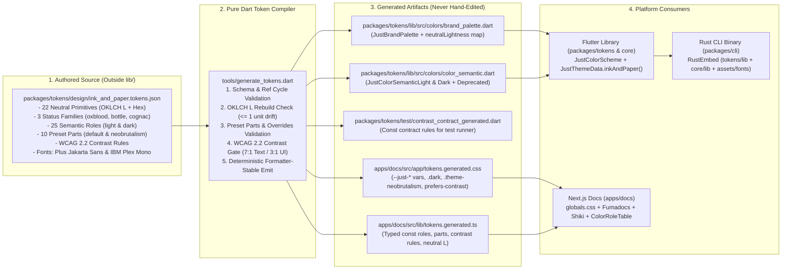
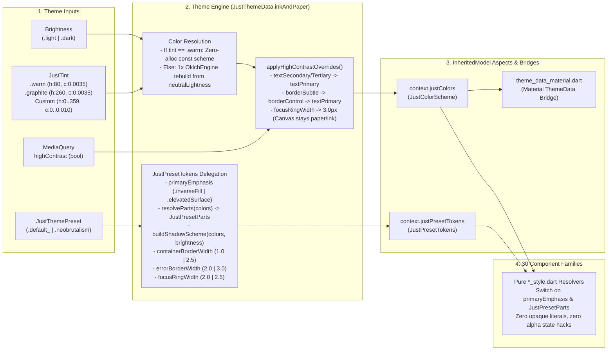

# JustUI "Ink and Paper" Rebrand: Master Tracker, Architecture Diagrams & API Contracts

- **PRD Baseline Version:** Draft v4 (2026-10-15)
- **Repository:** `https://github.com/infinitedim/justui`
- **Baseline Commit:** `development` @ `d80b55e` (2026-10-13)
- **Feature Branch:** `feat/ink-and-paper`
- **Target Release:** `v0.15.0` (Minor release with deprecations — `DP-1`)
- **Owner:** Dimas (`infinitedim`)

---

## 1. Visualisasi Arsitektur & Alur Eksekusi (Mermaid Horizontal `LR`)

### 1.1 Diagram Master: Alur Eksekusi Fase (P0 - P9) & Ketergantungan Task (`flowchart LR`)

Diagram ini memetakan seluruh urutan fase dan _task_ dari kiri ke kanan (`LR`), termasuk percabangan paralel antara jalur **Flutter Library (P2–P5)**, **Next.js Docs (P6–P7)**, dan **Rust CLI (P8)** sebelum menyatu di **Release Gate (P9)**.

```mermaid
flowchart LR
  classDef phase01 fill:#f3f1ef,stroke:#11100f,stroke-width:2px,color:#11100f
  classDef flutterTrack fill:#fbfaf8,stroke:#11100f,stroke-width:2px,color:#11100f
  classDef docsTrack fill:#e1dfdd,stroke:#11100f,stroke-width:1.5px,color:#11100f
  classDef cliTrack fill:#ffffff,stroke:#42413f,stroke-width:2px,color:#11100f
  classDef releaseGate fill:#11100f,stroke:#11100f,stroke-width:2.5px,color:#fbfaf8
  classDef deprecatedNode fill:#f3f1ef,stroke:#81807d,stroke-dasharray: 4 4,color:#646361

  subgraph P0["Phase 0: Baseline & Safety Nets"]
    direction LR
    P0_T1["P0.T1: Approve PRD v4 & DP-1..14"] --> P0_T2["P0.T2: Rule Patches (FR-0.4)"]
    P0_T1 --> P0_T3["P0.T3: Branch feat/ink-and-paper"]
    P0_T3 --> P0_T4["P0.T4: Fix globals.css Comment + Test"]
    P0_T3 --> P0_T5["P0.T5: Flutter color_guard_test.dart"]
    P0_T3 --> P0_T6["P0.T6: Docs style-guards.test.ts"]
    P0_T4 --> P0_T7["P0.T7: Changeset Fix Fumadocs"]
  end

  subgraph P1["Phase 1: Token Source & Generator"]
    direction LR
    P1_T1["P1.T1: Author ink_and_paper.tokens.json"] --> P1_T2["P1.T2: Build generate_tokens.dart + Tests"]
    P1_T2 --> P1_T3["P1.T3: Emit Dart, CSS, TS & Contract"]
    P1_T3 --> P1_T4["P1.T4: Add --check to DoD"]
  end

  subgraph P2["Phase 2: Flutter Tokens API"]
    direction LR
    P2_T1["P2.T1: 25 Roles + 10 Deprecated Getters"] --> P2_T2["P2.T2: Wire color_semantic.dart & Aliases"]
    P2_T2 --> P2_T3["P2.T3: Deprecate Palette & Export Brand"]
    P2_T1 --> P2_T4["P2.T4: CustomColorScheme.roles + Legacy Const"]
    P2_T1 --> P2_T5["P2.T5: isAccessibleAaaWith Helper"]
    P2_T2 --> P2_T6["P2.T6: Contrast Contract & Parity Tests"]
    P2_T1 --> P2_T6b["P2.T6b: PlusJakartaSans + .ttf Assets (AC-2.10)"]
    P2_T6 --> P2_T7["P2.T7: Changeset just_ui_tokens"]
  end

  subgraph P3["Phase 3: Core Theme Engine"]
    direction LR
    P3_T1["P3.T1: JustPresetTokens + resolveParts"] --> P3_T2["P3.T2: InkShadowScheme & Neobrutalism Shadow"]
    P3_T1 --> P3_T3["P3.T3: JustTint + inkAndPaper + Deprecate fromSeed"]
    P3_T2 --> P3_T3
    P3_T3 --> P3_T4["P3.T4: High Contrast Hierarchy Collapse"]
    P3_T3 --> P3_T5["P3.T5: Material Bridge Remap"]
    P3_T4 --> P3_T6["P3.T6: Theme Tests + Changeset"]
    P3_T5 --> P3_T6
  end

  subgraph P4["Phase 4: 30 Component Migration"]
    direction LR
    P4_BA["Batch A (High Risk): 11 Families + Registry Sync"] --> P4_BB["Batch B (Medium Risk): 13 Families + Registry Sync"]
    P4_BB --> P4_BC["Batch C (Low Risk): 6 Families + Registry Sync"]
    P4_BC --> P4_GOLD["P4.Goldens: FontLoader + Linux Baselines"]
  end

  subgraph P8["Phase 8: Rust CLI (justui)"]
    direction LR
    P8_T1["P8.T1: New just_theme.dart Template"] --> P8_T2["P8.T2: --tint, --tint-hue, --no-font, oklch.rs"]
    P8_T1 --> P8_T4b["P8.T4b: FontAssets Binary Embed + pubspec_editor"]
    P8_T3["P8.T3: Doctor Stale Tokens & Font Check"] --> P8_T4["P8.T4: CLI Snapshot & Unit Tests"]
    P8_T2 --> P8_T4
    P8_T4b --> P8_T4
    P8_T4 --> P8_T5["P8.T5: Changeset justui_cli"]
  end

  subgraph P5["Phase 5: Registry, Showcase & Preview"]
    direction LR
    P5_T1["P5.T1: Final Registry Checksum & Sign"] --> P5_T2["P5.T2: Identical-Preset Guard"]
    P5_T3["P5.T3: Preview tokens_usecases.dart"] --> P5_T4["P5.T4: 29 Component Usecases (4 Combos)"]
    P5_T2 --> P5_T5["P5.T5: Regenerate apps/showcase via CLI"]
    P5_T4 --> P5_T5
  end

  subgraph P6["Phase 6: Docs Foundation"]
    direction LR
    P6_T1["P6.T1: Import tokens.generated.css + Aliases"] --> P6_T2["P6.T2: @theme, Fumadocs body & ::selection"]
    P6_T2 --> P6_T3["P6.T3: Focus Ring Var, Links, Forced Colors"]
    P6_T1 --> P6_T4["P6.T4: Monochrome Shiki (Plex Mono w500)"]
    P6_T1 --> P6_T4b["P6.T4b: Swap to Plus_Jakarta_Sans"]
    P6_T3 --> P6_T5["P6.T5: Vitest & Playwright Foundation Tests"]
    P6_T4 --> P6_T5
    P6_T4b --> P6_T5
  end

  subgraph P7["Phase 7: Docs UI & Content (Non-Docs Deprecated)"]
    direction LR
    P7_T0["P7.T0: Split In-Scope vs Deprecated Graph"] --> P7_T1["P7.T1: Accent Sweep G1 & G2 (In-Scope)"]
    P7_T1 --> P7_T2["P7.T2: Accent Sweep G3, G4, G5 (In-Scope)"]
    P7_T0 --> P7_T3["P7.T3: Status Sweep (In-Scope)"]
    P7_DEP["P7.T4..T6: Studio & Landing (DEPRECATED -> OS-2)"]:::deprecatedNode
    P7_T2 --> P7_T7["P7.T7: Shrink Aliases & Close In-Scope Ratchets"]
    P7_T3 --> P7_T7
    P7_T8["P7.T8: MDX (en/id) + ColorRoleTable + Migration"] --> P7_T9["P7.T9: axe AAA Gate (Docs Only) + README Badge"]
    P7_T7 --> P7_T9
    P7_T9 --> P7_T10["P7.T10: Changeset docs"]
  end

  subgraph P9["Phase 9: Verification & Release Gate"]
    direction LR
    P9_T1["P9.T1: Sandbox Checks (V-1..V-6, V-14, V-18, V-19)"] --> P9_T2["P9.T2: Owner Checks (V-7..V-13, V-15..V-17)"]
    P9_T2 --> P9_T3["P9.T3: Record Metrics M1..M10"]
    P9_T3 --> P9_T4["P9.T4: Changelog & Dry-Run Version Bumps"]
    P9_T3 --> P9_T5["P9.T5: Audit Migration Guide Snippets"]
    P9_T4 --> P9_T6["P9.T6: Write verification-report.md"]
    P9_T5 --> P9_T6
    P9_T6 --> P9_T7["P9.T7: Owner Release Sign-Off (v0.15.0)"]
  end

  P0_T2 --> P1_T1
  P0_T5 --> P1_T1
  P0_T6 --> P1_T1
  P1_T4 --> P2_T1
  P1_T4 --> P6_T1
  P2_T7 --> P3_T1
  P2_T6b --> P8_T4b
  P2_T1 --> P8_T3
  P3_T6 --> P4_BA
  P3_T6 --> P5_T3
  P3_T6 --> P7_T8
  P3_T6 --> P8_T1
  P4_GOLD --> P5_T1
  P4_GOLD --> P5_T4
  P8_T1 --> P5_T5
  P8_T4b --> P5_T5
  P6_T5 --> P7_T0
  P5_T5 --> P9_T1
  P7_T10 --> P9_T1
  P8_T5 --> P9_T1

  class P0,P1 phase01
  class P2,P3,P4,P5 flutterTrack
  class P6,P7 docsTrack
  class P8 cliTrack
  class P9 releaseGate
```



---

### 1.2 Diagram Pipeline Token: Single Source of Truth Menuju Multi-Platform (`flowchart LR`)

Diagram ini menjelaskan bagaimana satu file JSON di luar `lib/` menjadi satu-satunya tempat penulisan warna (`M8 = 1`) dan dikompilasi ke seluruh target ekosistem.



---

### 1.3 Diagram Arsitektur Runtime Theme Engine & Resolusi Komponen (`flowchart LR`)

Diagram ini memvisualisasikan bagaimana parameter tema di-resolve pada saat _runtime_ tanpa satupun percabangan `preset == .neobrutalism` (`M6 = 0`) atau `showsDefaultBorder` (`M5 = 0`) di dalam komponen.



---

## 2. Master Status Tracker: Per Phase & Per Task

Gunakan kotak centang (`[ ]` / `[x]`) di bawah ini untuk memantau progres pengerjaan oleh AI Agent maupun verifikasi di _Owner Machine_.

### Ringkasan Status per Fase

| Phase  | Nama Fase                         | Dokumen PRD                                | Bergantung Pada    | Lingkungan Uji Utama          | Progress Task   | Status        |
| :----- | :-------------------------------- | :----------------------------------------- | :----------------- | :---------------------------- | :-------------- | :------------ |
| **P0** | Baseline and Safety Nets          | `10-phase-0-baseline-and-safety-nets.md`   | Approval PRD v4    | Sandbox + Owner Machine       | `0 / 7`         | `[ ] Pending` |
| **P1** | Token Source and Generator        | `11-phase-1-token-source-and-generator.md` | P0                 | Sandbox (Pure Dart + Vitest)  | `0 / 4`         | `[ ] Pending` |
| **P2** | Tokens API                        | `12-phase-2-tokens-api.md`                 | P1                 | Sandbox + Owner Machine       | `0 / 8`         | `[ ] Pending` |
| **P3** | Core Theme Engine                 | `13-phase-3-core-theme-engine.md`          | P2                 | Sandbox + Owner Machine       | `0 / 6`         | `[ ] Pending` |
| **P4** | Component Migration (30 Families) | `14-phase-4-component-migration.md`        | P3                 | Owner Machine + Linux CI      | `0 / 4 Batches` | `[ ] Pending` |
| **P5** | Registry, Showcase and Preview    | `15-phase-5-registry-showcase-preview.md`  | P4, P8.T1, P8.T4b  | Owner Machine                 | `0 / 5`         | `[ ] Pending` |
| **P6** | Docs Foundation                   | `16-phase-6-docs-foundation.md`            | P0, P1             | Sandbox + Owner Machine (e2e) | `0 / 6`         | `[ ] Pending` |
| **P7** | Docs UI and Content               | `17-phase-7-docs-ui-and-content.md`        | P6, P3             | Sandbox + Owner Machine (axe) | `0 / 8 Active`  | `[ ] Pending` |
| **P8** | CLI (`justui` Rust Crate)         | `18-phase-8-cli.md`                        | P2 (`AC-2.10`), P3 | Sandbox (`cargo`) + Owner     | `0 / 6`         | `[ ] Pending` |
| **P9** | Verification and Release Gate     | `19-phase-9-verification-and-release.md`   | P0 s/d P8          | Sandbox + Owner Machine       | `0 / 7`         | `[ ] Pending` |

---

### Detail Checklist per Task (P0 - P9)

#### Phase 0: Baseline and Safety Nets

- [ ] **`P0.T1`** — Owner menyetujui PRD Draft v4 dan keputusan `DP-1` s/d `DP-14` di `90-pending-decisions.md`.
- [ ] **`P0.T2`** — Tulis _unified-diff patches_ untuk `.agents/rules/{design,flutter,docs-web}.md` dan `AGENTS.md` (`FR-0.4`); Owner menerapkan patch sebelum P1 dimulai (`AC-0.7`).
- [ ] **`P0.T3`** — Buat branch `feat/ink-and-paper` dari `development` (`d80b55e`), commit lokal saja (`FR-0.5`).
- [ ] **`P0.T4`** — Buat `apps/docs/test/globals-css.test.ts` (pastikan gagal di baseline), tutup komentar `/*` yang menggantung di `apps/docs/src/app/globals.css:297` sebelum `body {`, lalu pastikan tes lulus (`FR-0.1`, `AC-0.1`, `AC-0.2`).
- [ ] **`P0.T5`** — Buat `packages/core/test/color_guard_test.dart` dengan aturan regex `CG-1` s/d `CG-7` dan _ratchet allow-list_ sesuai angka baseline (`FR-0.2`, `AC-0.3`, `AC-0.4`).
- [ ] **`P0.T6`** — Perluas `apps/docs/test/style-guards.test.ts` dengan `ACCENT_ALLOWED` (54 file), `STATUS_ALLOWED` (12 file), dan 4 _hard bans_ (`focus-visible:outline-accent`, `bg-black`, `bg-white`, `text-white`) (`FR-0.3`, `AC-0.5`).
- [ ] **`P0.T7`** — Tambahkan changeset `.changeset/fix-fumadocs-token-mapping.md` (`"docs": patch`) dan jalankan `bun run lint`, `bun run type-check`, `bun run test`, serta `flutter analyze` (`AC-0.6`).

#### Phase 1: Token Source and Generator

- [ ] **`P1.T1`** — Buat `packages/tokens/design/ink_and_paper.tokens.json` (di luar `lib/`) dengan seluruh nilai primitif, 25 role, 10 preset parts (`default` & `neobrutalism`), aturan kontras, dan objek `fonts` (`sans: { css, flutter }`, `mono: { css }`) (`FR-1.1` s/d `FR-1.3`, `AC-1.1`).
- [ ] **`P1.T2`** — Implementasikan `tools/generate_tokens.dart` (beserta helper di `tools/tokens/*.dart`) dan unit test di `tools/test/generate_tokens_test.dart` (`FR-1.4`, `FR-1.6`, `AC-1.3`).
- [ ] **`P1.T3`** — Jalankan generator untuk mengeluarkan `brand_palette.dart`, `contrast_contract_generated.dart`, `tokens.generated.css`, dan `tokens.generated.ts` (sementara `color_semantic.dart` ke path sementara) (`FR-1.5`, `AC-1.4` s/d `AC-1.7`).
- [ ] **`P1.T4`** — Pastikan `dart run tools/generate_tokens.dart --check` menghasilkan exit code 0 dan masuk ke _Definition of Done_ (`AC-1.2`).

#### Phase 2: Tokens API

- [ ] **`P2.T1`** — Tambahkan 25 abstract getters baru dan 10 `@Deprecated` concrete forwarding getters pada `JustColorScheme` di `packages/tokens/lib/src/colors/color_tokens.dart`; perbarui `operator ==` dan `hashCode` agar hanya membandingkan 25 role aktif (`FR-2.1` s/d `FR-2.3`, `AC-2.1`, `AC-2.2`).
- [ ] **`P2.T2`** — Arahkan generator untuk menulis `packages/tokens/lib/src/colors/color_semantic.dart` secara langsung; hubungkan `_JustColorSchemeLight` & `_JustColorSchemeDark`; ubah skema neobrutalism menjadi `@Deprecated` alias ke skema light/dark (`FR-2.4`, `AC-2.3`, `AC-2.5`, `AC-2.6`).
- [ ] **`P2.T3`** — Beri anotasi `@Deprecated` pada `JustColorPalette` dan 68 re-export `JustColors.<family><step>`; ekspos `JustColors.brand` dan export `brand_palette.dart` dari `lib/just_ui_tokens.dart` (`FR-2.4`, `FR-2.5`).
- [ ] **`P2.T4`** — Tambahkan `const CustomColorScheme.roles({...})`, pertahankan `const CustomColorScheme({...})` dengan 16 parameter lama sebagai `@Deprecated` (untuk menjaga `M9 = 0`), tambahkan `copyWith`, dan deprekasi `resolveSemantic` (`FR-2.6`).
- [ ] **`P2.T5`** — Tambahkan helper `isAccessibleAaaWith(Color background, {bool largeText = false})` di `colors_accessibility.dart` (`FR-2.9`).
- [ ] **`P2.T6`** — Buat `contrast_contract_test.dart` (dengan _hand-written floors_), `custom_scheme_test.dart`, parity test OKLCH, dan perbarui `colors_test.dart` (`FR-2.8`, `FR-2.10`, `AC-2.4`, `AC-2.8`).
- [ ] **`P2.T6b`** — Ubah default `fontFamily` di `typography.dart:9` menjadi `'PlusJakartaSans'`; commit 4 file `.ttf` (`PlusJakartaSans-{Regular,Medium,SemiBold,Bold}.ttf`) dan `OFL.txt` ke `packages/tokens/assets/fonts/` tanpa mendeklarasikannya di `packages/tokens/pubspec.yaml` (`FR-2.11`, `AC-2.10`).
- [ ] **`P2.T7`** — Tambahkan changeset `.changeset-polyglot/ink-and-paper-tokens.md` (`"just_ui_tokens": minor`) (`AC-2.7`, `AC-2.9`).

#### Phase 3: Core Theme Engine

- [ ] **`P3.T1`** — Tambahkan 14 member baru pada `JustPresetTokens` (termasuk enum `JustPrimaryEmphasis` dan `JustPresetParts resolveParts(JustColorScheme c)` yang memetakan `"transparent"` ke `Color(0x00000000)`), serta beri `@Deprecated` pada `showsDefaultBorder` (`FR-3.1`, `FR-3.2`).
- [ ] **`P3.T2`** — Implementasikan `InkShadowScheme`, wajibkan parameter `shadowColor` pada `NeobrutalismShadowScheme`, perbarui `packages/tokens/lib/src/shadows.dart`, dan deprekasi `TintedShadowScheme` (`FR-3.3`, `AC-3.7`).
- [ ] **`P3.T3`** — Buat `packages/core/lib/src/theme/tint.dart` (`class const JustTint` dengan `assert` di initializer list + `factory JustTint.clamped`), tambahkan factory `JustThemeData.inkAndPaper`, delegasikan `shadowOffset`/`resolveShadows` ke `presetTokens`, dan deprekasi `fromSeed` dengan konversi Option D (`FR-3.4`, `AC-3.1` s/d `AC-3.4`).
- [ ] **`P3.T4`** — Tulis ulang `applyHighContrastOverrides` agar mempertahankan kanvas kertas/tinta dan meruntuhkan hirarki teks/border (`FR-3.5`, `AC-3.5`).
- [ ] **`P3.T5`** — Petakan ulang `packages/core/lib/src/theme/theme_data_material.dart` ke role baru sambil menjaga baris anchor `// CLI:REGISTER_EXTENSIONS` tetap identik byte-per-byte (`FR-3.6`, `AC-3.6`).
- [ ] **`P3.T6`** — Perbarui `theme_test.dart`, `theme_schemes_test.dart`, `accessibility_semantics_test.dart`, dan buat changeset `.changeset-polyglot/ink-and-paper-core.md` (`AC-3.8`).

#### Phase 4: Component Migration (30 Families)

- [ ] **`P4.BatchA`** — Migrasi 11 keluarga komponen berisiko tinggi (`button`/`icon-button`, `input`, `select`, `date_picker`/`date_range_picker`, `time_picker`, `badge`, `avatar`, `toast`, `checkbox`, `switch`, `slider`), sinkronisasi + sign registry, turunkan ratchet `color_guard_test.dart`, dan perbarui widget tests (`Section 7`, `Section 10`).
- [ ] **`P4.BatchB`** — Migrasi 13 keluarga komponen berisiko menengah (`tabs`/`tab_indicator`, `toggle`, `table`, `sidebar`, `carousel` termasuk `@Deprecated JustCarouselTheme.neobrutalism`, `resizable`, `progress`, `radio`, `breadcrumb`, `bottom_nav`, `card`, `skeleton`, `shared focus indicator`), sinkronisasi + sign registry, turunkan ratchet guard (`Section 8`, `Section 10`).
- [ ] **`P4.BatchC`** — Migrasi 6 keluarga komponen berisiko rendah (`accordion`, `dialog`/`sheet`, `tooltip`, `separator`, `scroll_area`, `shared pressable/overlays/spinner`), sinkronisasi + sign registry, kunci target akhir `color_guard_test.dart` dan tes nol pembacaan getter `@Deprecated` di `components/` (`Section 9`, `AC-4.1` s/d `AC-4.4`).
- [ ] **`P4.Goldens`** — Tambahkan `packages/core/test/flutter_test_config.dart` untuk memuat 4 file `.ttf` `PlusJakartaSans` via `FontLoader`, lalu rekam dan tinjau _golden baselines_ pada mesin Linux (`ubuntu-latest`) untuk 4 kombinasi (`Section 13`, `AC-4.5`, `AC-4.6`).

#### Phase 5: Registry, Showcase and Preview

- [ ] **`P5.T1`** — Jalankan `dart run tools/generate_checksums.dart` dan tandatangani ulang registry dengan `cargo run -p justui -- sign-registry` (`FR-5.1`, `AC-5.1`).
- [ ] **`P5.T2`** — Tambahkan _identical-preset guard_ di `tools/generate_checksums.dart` dan uji dengan folder preset tiruan yang identik (`FR-5.2`, `AC-5.2`).
- [ ] **`P5.T3`** — Tulis ulang `apps/preview/lib/usecases/tokens_usecases.dart` (tabel role live dengan rasio kontras runtime, knob tint hue/chroma, nol literal warna) dan daftarkan font `PlusJakartaSans` di `apps/preview/pubspec.yaml` (`FR-5.4`, `AC-5.6`).
- [ ] **`P5.T4`** — Perbarui 29 file component use-case di `apps/preview/lib/usecases/` untuk mencakup 4 kombinasi dan semua state; jalankan `build_runner` (`FR-5.5`, `AC-5.5`).
- [ ] **`P5.T5`** — Regenerasi `apps/showcase` menggunakan biner CLI baru (`justui init -y --preset neobrutalism ...` + `justui add --all -y`), format, analyze, dan jalankan `flutter test` (`FR-5.3`, `AC-5.3`, `AC-5.4`).

#### Phase 6: Docs Foundation

- [ ] **`P6.T1`** — Import `./tokens.generated.css` di `apps/docs/src/app/globals.css`, hapus ~104 nilai hex manual, dan tambahkan blok _transitional aliases_ (`FR-6.1`, `FR-6.2`, `AC-6.1`).
- [ ] **`P6.T2`** — Petakan `@theme` Tailwind v4, variabel `--color-fd-*` Fumadocs di blok `body`, dan `::selection` (`FR-6.2`, `FR-6.3`, `AC-6.4`).
- [ ] **`P6.T3`** — Definisikan `--just-focus-ring-width` (`2px` / `2.5px` / `3px`), perbarui `focusRing` dan `link` di `ui-classes.ts`, tambahkan `@media (forced-colors: active)` & `@media (prefers-contrast: more)`, serta `viewport.themeColor` (`FR-6.4`, `FR-6.5`, `AC-6.5` s/d `AC-6.7`).
- [ ] **`P6.T4`** — Hubungkan `src/lib/justui-shiki-theme.ts` dan `--just-syn-*` ke `tokens.generated.ts` dengan IBM Plex Mono weight 500 untuk keyword (`FR-6.6`, `AC-6.3`).
- [ ] **`P6.T4b`** - Ganti `IBM_Plex_Sans` menjadi `Plus_Jakarta_Sans` (weights 400, 500, 600, 700) di `src/app/[lang]/layout.tsx` tanpa menyentuh _inline preset script_, hapus IBM Plex Sans sepenuhnya, dan batasi IBM Plex Mono hanya untuk teks monospace (`FR-6.7`, `FR-6.8`, `AC-6.9`).
- [ ] **`P6.T5`** — Tambahkan Vitest contrast & Shiki tests serta Playwright foundation specs; jalankan `bun run lint`, `type-check`, `test`, dan `build` (`Section 9`, `AC-6.2`, `AC-6.8`).

#### Phase 7: Docs UI and Content (Non-Docs Pages Deprecated)

- [ ] **`P7.T0`** — Bangun pemisahan daftar file **In-Scope** (`/[lang]/docs/**` + shared shell) vs **Deprecated** (`/[lang]`, `/[lang]/components`, `/[lang]/studio`, `not-found`) dari _import graph_ (`Section 0.3`).
- [ ] **`P7.T1`** — Lakukan _accent sweep_ pada file In-Scope di grup **G1** dan **G2** sesuai tabel makna `FR-7.1`; turunkan allow-list di `style-guards.test.ts`.
- [ ] **`P7.T2`** — Lakukan _accent sweep_ pada file In-Scope di grup **G3**, **G4**, dan **G5** (`FR-7.1`).
- [ ] **`P7.T3`** — Lakukan _status sweep_ pada file In-Scope di `FR-7.2` (wajib ada glyph + teks pendamping).
- [ ] ~~**`P7.T4` s/d `P7.T6`**~~ — _DEPRECATED: Studio tint picker, URL serializer, code export, parity test, dan landing page dipindah ke proyek redesign (`91-out-of-scope.md` `OS-2`)._
- [ ] **`P7.T7`** — Susutkan blok alias di `globals.css` hanya untuk yang masih dipakai file deprecated (beri komentar `OS-2`), dan kunci `ACCENT_ALLOWED` serta 4 _hard bans_ di `style-guards.test.ts` agar kosong untuk seluruh file In-Scope (`FR-7.8`, `AC-7.1` s/d `AC-7.4`).
- [ ] **`P7.T8`** — Buat komponen server `ColorRoleTable`, tulis ulang halaman MDX (`en` dan `id` dalam commit yang sama), dan tambahkan `guides/migrate-ink-and-paper.mdx` (`FR-7.9`, `AC-7.8`).
- [ ] **`P7.T9`** — Perbarui `e2e/accessibility.spec.ts` dengan tag `wcag2aaa` & `wcag22aa` pada 4 halaman docs In-Scope (landing page sebagai _informational_), regenerasi snapshot baselines, dan ubah badge `README.md:10` dari `lime` ke `11100f` (`FR-7.10`, `FR-7.11`, `AC-7.9`, `AC-7.11`).
- [ ] **`P7.T10`** — Tambahkan changeset `.changeset/ink-and-paper-docs.md` (`"docs": minor`).

#### Phase 8: CLI (`packages/cli`)

- [ ] **`P8.T1`** — Perbarui template `lib/core/theme/just_theme.dart` di `src/commands/init.rs` agar menulis `JustThemeData.inkAndPaper` (`FR-8.4`).
- [ ] **`P8.T2`** — Tambahkan flag `--tint`, `--tint-hue`, `--no-font`, depresiasi `--seed` (konversi via `src/utils/oklch.rs`), dan perbarui prompt interaktif (`FR-8.1` s/d `FR-8.3`).
- [ ] **`P8.T3`** — Tambahkan pemeriksaan token lawas (`Color get inverse`) dan pemeriksaan font `PlusJakartaSans` di `src/commands/doctor.rs` (`FR-8.5`).
- [ ] **`P8.T4b`** — Tambahkan struct `FontAssets` (`#[derive(RustEmbed)]` untuk `../tokens/assets/fonts/`) dengan penulisan _raw bytes_ di `embedded_templates.rs`, serta fungsi penyisipan blok `flutter: fonts:` di `pubspec_editor.rs` (`FR-8.6`, `FR-8.9`).
- [ ] **`P8.T4`** — Tulis dan perbarui pengujian di `init_tests.rs`, `doctor_tests.rs`, `oklch.rs`, dan `tests/cli_tests.rs`; pastikan 5 _area checks_ Rust lulus (`FR-8.7`, `AC-8.1` s/d `AC-8.7`).
- [ ] **`P8.T5`** — Tambahkan changeset `.changeset-polyglot/cli-ink-and-paper-init.md` (`"justui_cli": minor`) (`FR-8.8`).

#### Phase 9: Verification and Release Gate

- [ ] **`P9.T1`** — Jalankan pemeriksaan Sandbox: `V-1` s/d `V-6`, skrip simulasi buta warna `V-14` (Machado 2009), latihan preset baru `V-18` (`M10 <= 5`), dan audit ASCII/Unicode `V-19` (`FR-9.1`).
- [ ] **`P9.T2`** — Jalankan pemeriksaan Owner Machine: `V-7` s/d `V-13`, daftar periksa neobrutalism `V-15`, alur penuh CLI `V-16`, dan tes _upgrade path_ `V-17` (`M9 = 0`) (`FR-9.1`).
- [ ] **`P9.T3`** — Rekam hasil akhir metrik `M1` s/d `M10` (`FR-9.2`, `AC-9.2`).
- [ ] **`P9.T4`** — Perbarui `CHANGELOG.md` (`Breaking`, `Added`, `Deprecated`, `Fixed`) dan jalankan _dry-run_ skrip changeset (`apply_changesets.dart --dry-run` & `apply_changesets_cargo.sh --dry-run`) (`FR-9.3`, `FR-9.5`, `AC-9.3`, `AC-9.4`).
- [ ] **`P9.T5`** — Audit kelengkapan simbol `@Deprecated` dan kompilasi snippet pada `guides/migrate-ink-and-paper.mdx` (`en` & `id`) (`FR-9.6`, `AC-9.5`).
- [ ] **`P9.T6`** — Tulis laporan lengkap di `docs/ink-and-paper/verification-report.md` (`FR-9.4`, `AC-9.1`).
- [ ] **`P9.T7`** — Tinjauan akhir dan persetujuan rilis (`v0.15.0`) oleh Owner (`FR-9.7`, `AC-9.6`).

---

## 3. Spesifikasi API Contract Lengkap (Lintas Layer)

Bagian ini merangkum seluruh kontrak antarmuka, tipe data, tanda tangan fungsi, dan pemetaan variabel yang harus dipatuhi secara ketat oleh agen AI di setiap fase.

### 3.1 Layer 1: Single Token Source JSON Contract (`P1`)

**File Path:** `packages/tokens/design/ink_and_paper.tokens.json` (Wajib berada di luar `lib/` agar tidak ikut ter-embed oleh `RustEmbed`).

```json
{
  "meta": {
    "version": 1,
    "name": "ink-and-paper"
  },
  "tint": {
    "default": { "hue": 80, "chroma": 0.0035 },
    "graphite": { "hue": 260, "chroma": 0.0035 }
  },
  "neutral": {
    "n1000": { "$type": "color", "$value": "#ffffff", "oklchL": 1.0 },
    "n985": { "$type": "color", "$value": "#fbfaf8", "oklchL": 0.985 },
    "n959": { "$type": "color", "$value": "#f3f1ef", "oklchL": 0.959 },
    "n955": { "$type": "color", "$value": "#f1f0ee", "oklchL": 0.955 },
    "n905": { "$type": "color", "$value": "#e1dfdd", "oklchL": 0.905 },
    "n861": { "$type": "color", "$value": "#d2d1ce", "oklchL": 0.861 },
    "n815": { "$type": "color", "$value": "#c4c2c0", "oklchL": 0.815 },
    "n799": { "$type": "color", "$value": "#bfbdbb", "oklchL": 0.799 },
    "n745": { "$type": "color", "$value": "#aeaca9", "oklchL": 0.745 },
    "n660": { "$type": "color", "$value": "#93928f", "oklchL": 0.66 },
    "n600": { "$type": "color", "$value": "#81807d", "oklchL": 0.6 },
    "n560": { "$type": "color", "$value": "#767472", "oklchL": 0.56 },
    "n500": { "$type": "color", "$value": "#646361", "oklchL": 0.5 },
    "n431": { "$type": "color", "$value": "#51504d", "oklchL": 0.431 },
    "n376": { "$type": "color", "$value": "#42413f", "oklchL": 0.376 },
    "n349": { "$type": "color", "$value": "#3b3a38", "oklchL": 0.349 },
    "n285": { "$type": "color", "$value": "#2b2a28", "oklchL": 0.285 },
    "n227": { "$type": "color", "$value": "#1d1c1a", "oklchL": 0.227 },
    "n192": { "$type": "color", "$value": "#151412", "oklchL": 0.192 },
    "n174": { "$type": "color", "$value": "#11100f", "oklchL": 0.174 },
    "n155": { "$type": "color", "$value": "#0d0c0a", "oklchL": 0.155 },
    "n135": { "$type": "color", "$value": "#090807", "oklchL": 0.135 }
  },
  "status": {
    "error": { "light": "#901114", "dark": "#f8a59b" },
    "errorHover": { "light": "#9a1f1d", "dark": "#e9978d" },
    "errorTint": { "light": "#fef0ee", "dark": "#241513" },
    "success": { "light": "#115629", "dark": "#99cda3" },
    "successTint": { "light": "#edf6ee", "dark": "#111d13" },
    "warning": { "light": "#723f00", "dark": "#e3b47d" },
    "warningTint": { "light": "#faf2e9", "dark": "#21170c" }
  },
  "alpha": {
    "scrim": {
      "light": { "base": "{neutral.n174}", "alpha": 0.48 },
      "dark": { "base": "{neutral.n135}", "alpha": 0.72 }
    }
  },
  "roles": {
    "light": {
      "canvas": "{neutral.n985}",
      "surface": "{neutral.n1000}",
      "raised": "{neutral.n1000}",
      "sunken": "{neutral.n959}",
      "hoverFill": "{neutral.n959}",
      "selection": "{neutral.n905}",
      "scrim": "{alpha.scrim.light}",
      "textPrimary": "{neutral.n174}",
      "textSecondary": "{neutral.n376}",
      "textTertiary": "{neutral.n431}",
      "textDisabled": "{neutral.n660}",
      "onInverse": "{neutral.n985}",
      "borderSubtle": "{neutral.n905}",
      "borderControl": "{neutral.n600}",
      "focusRing": "{neutral.n174}",
      "inverse": "{neutral.n174}",
      "inverseHover": "{neutral.n285}",
      "inversePressed": "{neutral.n349}",
      "error": "{status.error.light}",
      "errorHover": "{status.errorHover.light}",
      "errorTint": "{status.errorTint.light}",
      "success": "{status.success.light}",
      "successTint": "{status.successTint.light}",
      "warning": "{status.warning.light}",
      "warningTint": "{status.warningTint.light}"
    },
    "dark": {
      "canvas": "{neutral.n155}",
      "surface": "{neutral.n192}",
      "raised": "{neutral.n227}",
      "sunken": "{neutral.n135}",
      "hoverFill": "{neutral.n227}",
      "selection": "{neutral.n349}",
      "scrim": "{alpha.scrim.dark}",
      "textPrimary": "{neutral.n955}",
      "textSecondary": "{neutral.n815}",
      "textTertiary": "{neutral.n745}",
      "textDisabled": "{neutral.n500}",
      "onInverse": "{neutral.n155}",
      "borderSubtle": "{neutral.n285}",
      "borderControl": "{neutral.n560}",
      "focusRing": "{neutral.n955}",
      "inverse": "{neutral.n955}",
      "inverseHover": "{neutral.n861}",
      "inversePressed": "{neutral.n799}",
      "error": "{status.error.dark}",
      "errorHover": "{status.errorHover.dark}",
      "errorTint": "{status.errorTint.dark}",
      "success": "{status.success.dark}",
      "successTint": "{status.successTint.dark}",
      "warning": "{status.warning.dark}",
      "warningTint": "{status.warningTint.dark}"
    }
  },
  "presets": {
    "default": {
      "parts": {
        "primaryBg": "inverse",
        "primaryFg": "onInverse",
        "primaryBorder": "inverse",
        "secondaryBg": "transparent",
        "secondaryBorder": "borderControl",
        "containerBorder": "borderSubtle",
        "controlBorder": "borderControl",
        "shadowColor": "textPrimary",
        "selectedBg": "inverse",
        "selectedFg": "onInverse"
      },
      "roleOverrides": {}
    },
    "neobrutalism": {
      "parts": {
        "primaryBg": "surface",
        "primaryFg": "textPrimary",
        "primaryBorder": "textPrimary",
        "secondaryBg": "transparent",
        "secondaryBorder": "textPrimary",
        "containerBorder": "textPrimary",
        "controlBorder": "textPrimary",
        "shadowColor": "textPrimary",
        "selectedBg": "inverse",
        "selectedFg": "onInverse"
      },
      "roleOverrides": {}
    }
  },
  "fonts": {
    "sans": { "css": "Plus Jakarta Sans", "flutter": "PlusJakartaSans" },
    "mono": { "css": "IBM Plex Mono" }
  }
}
```

---

### 3.2 Layer 2: Flutter Tokens API Contract (`P2` — `packages/tokens`)

```dart
// 1. packages/tokens/lib/src/colors/brand_palette.dart (GENERATED)
abstract final class JustBrandPalette {
  static const Color n1000 = Color(0xFFFFFFFF);
  static const Color n985  = Color(0xFFFBFAF8);
  // ... all 22 neutral primitives + status primitives (oxblood, bottle, cognac)
  static const Map<String, double> neutralLightness = {
    'n1000': 1.0000,
    'n985': 0.9850,
    // ... all 22 steps
  };
}

// 2. packages/tokens/lib/src/colors/color_tokens.dart
abstract final class JustColorScheme {
  const JustColorScheme();

  // --- 25 Active Semantic Roles ---
  Color get canvas;
  Color get surface;
  Color get raised;
  Color get sunken;
  Color get hoverFill;
  Color get scrim;
  Color get selection;

  Color get textPrimary;
  Color get textSecondary;
  Color get textTertiary;
  Color get textDisabled;
  Color get onInverse;

  Color get borderSubtle;
  Color get borderControl;
  Color get focusRing;

  Color get inverse;
  Color get inverseHover;
  Color get inversePressed;

  Color get error;
  Color get errorHover;
  Color get errorTint;
  Color get success;
  Color get successTint;
  Color get warning;
  Color get warningTint;

  // --- 10 Deprecated Forwarding Getters (Removed in next minor release) ---
  @Deprecated('Use canvas instead. Removed in the next minor release.')
  Color get background => canvas;

  @Deprecated('Use surface instead. Removed in the next minor release.')
  Color get card => surface;

  @Deprecated('Use raised instead. Removed in the next minor release.')
  Color get elevated => raised;

  @Deprecated('Use sunken instead. Removed in the next minor release.')
  Color get muted => sunken;

  @Deprecated('Use scrim instead. Removed in the next minor release.')
  Color get overlay => scrim;

  @Deprecated('Use onInverse instead. Removed in the next minor release.')
  Color get textInverse => onInverse;

  @Deprecated('Use borderControl instead. Removed in the next minor release.')
  Color get borderDefault => borderControl;

  @Deprecated('Use inverse instead. Removed in the next minor release.')
  Color get borderFocus => inverse;

  @Deprecated('Use error instead. Removed in the next minor release.')
  Color get borderError => error;

  @Deprecated('Use textPrimary instead. Removed in the next minor release.')
  Color get info => textPrimary;

  // Equality & hashCode compare ONLY the 25 active roles (never deprecated getters).
}

// 3. CustomColorScheme Dual-Const Constructor Contract (Preserves M9 = 0)
final class CustomColorScheme extends JustColorScheme {
  // New primary API: all 25 roles required except scrim (defaults from textPrimary)
  const CustomColorScheme.roles({
    required this.canvas,
    required this.surface,
    required this.raised,
    required this.sunken,
    required this.hoverFill,
    Color? scrim,
    required this.selection,
    required this.textPrimary,
    required this.textSecondary,
    required this.textTertiary,
    required this.textDisabled,
    required this.onInverse,
    required this.borderSubtle,
    required this.borderControl,
    required this.focusRing,
    required this.inverse,
    required Color inverseHover,
    required Color inversePressed,
    required this.error,
    required Color errorHover,
    required Color errorTint,
    required this.success,
    required Color successTint,
    required this.warning,
    required Color warningTint,
  });

  // Legacy unnamed const constructor kept so existing `const CustomColorScheme(...)` compiles!
  @Deprecated('Use CustomColorScheme.roles. Removed in the next minor release.')
  const CustomColorScheme({
    required Color background,
    required Color card,
    required Color elevated,
    required Color muted,
    required Color overlay,
    required this.textPrimary,
    required this.textSecondary,
    required this.textDisabled,
    required Color textInverse,
    required Color borderDefault,
    required Color borderFocus,
    required Color borderError,
    required this.success,
    required this.warning,
    required this.error,
    required Color info,
  });

  CustomColorScheme copyWith({/* all 25 active roles */});
}

// 4. Accessibility Extension (colors_accessibility.dart)
extension JustColorAccessibility on Color {
  double contrastRatioWith(Color other);
  bool isAccessibleWith(Color background, {bool largeText = false});
  bool isAccessibleAaaWith(Color background, {bool largeText = false}); // >= 7.0 normal, >= 4.5 large
}
```

---

### 3.3 Layer 3: Flutter Core Theme Engine Contract (`P3` — `packages/core/lib/src/theme`)

```dart
// 1. packages/core/lib/src/theme/tint.dart
class const JustTint({double hue = 80.0, double chroma = 0.0035})
    : assert(hue >= 0.0 && hue < 360.0),
      assert(chroma >= 0.0 && chroma <= 0.010) {
  static const JustTint warm = JustTint();
  static const JustTint graphite = JustTint(hue: 260.0);

  factory JustTint.clamped({double hue = 80.0, double chroma = 0.0035}) {
    final normalizedHue = ((hue % 360.0) + 360.0) % 360.0;
    final clampedChroma = chroma.clamp(0.0, 0.010);
    return JustTint(hue: normalizedHue, chroma: clampedChroma);
  }
}

// 2. packages/core/lib/src/theme/preset_tokens.dart
enum JustPrimaryEmphasis { inverseFill, elevatedSurface }

class const JustPresetParts({
  required Color primaryBg,
  required Color primaryFg,
  required Color primaryBorder,
  required Color secondaryBg,
  required Color secondaryBorder,
  required Color containerBorder,
  required Color controlBorder,
  required Color shadowColor,
  required Color selectedBg,
  required Color selectedFg,
});

abstract class JustPresetTokens {
  const JustPresetTokens();

  Offset get shadowOffset; // Default: Offset.zero | Neobrutalism: Offset(4, 4)
  List<BoxShadow> resolvePressedShadows(List<BoxShadow> base, {required bool isPressed});
  JustPrimaryEmphasis get primaryEmphasis; // Default: .inverseFill | Neobrutalism: .elevatedSurface
  Color resolveContainerBorderColor(JustColorScheme c); // Default: c.borderSubtle | Neo: c.textPrimary
  Color resolveControlBorderColor(JustColorScheme c);   // Default: c.borderControl | Neo: c.textPrimary
  double get containerBorderWidth; // Default: 1.0 | Neobrutalism: 2.5
  double get focusRingWidth;       // Default: 2.0 | Neobrutalism: 2.5 (3.0 in High Contrast)
  double get focusRingGap;         // Both: 2.0
  double get errorBorderWidth;     // Default: 2.0 | Neobrutalism: 3.0
  JustShadowScheme buildShadowScheme(JustColorScheme c, Brightness b);
  JustMotionProfile get defaultMotion; // Default: standard | Neobrutalism: neobrutalism
  bool get selectedDropsShadow;        // Default: false | Neobrutalism: true
  double get secondaryShadowDepth;     // Default: 0.0 | Neobrutalism: 2.0
  FontWeight get primaryLabelWeight;   // Default: .w500 | Neobrutalism: .w700
  JustPresetParts resolveParts(JustColorScheme c);

  @Deprecated('Use the specific preset token instead.')
  bool get showsDefaultBorder;
}

// 3. packages/core/lib/src/theme/theme_data.dart
class JustThemeData {
  static JustThemeData inkAndPaper({
    required Brightness brightness,
    JustThemePreset preset = .default_,
    JustTint tint = .warm,
    JustTypographyScheme typography = const DefaultTypographyScheme(),
    JustSpacingScheme spacing = const DefaultSpacingScheme(),
    JustRadiusScheme radius = const DefaultRadiusScheme(),
    JustMotionProfile? animations,
    JustColorSpaceEngine colorSpace = .oklch,
  });

  @Deprecated('Use JustThemeData.inkAndPaper')
  static JustThemeData fromSeed({
    required Color seedColor,
    required Brightness brightness,
    JustThemePreset preset = .default_,
    JustColorSpaceEngine colorSpace = .oklch,
    // Converts seedColor to OKLCH: if chroma < 0.02 -> JustTint.warm, else JustTint.clamped(hue: seedHue)
  });
}
```

#### Tabel Pemetaan Material Bridge (`theme_data_material.dart` — `FR-3.6`)

| Material `ThemeData` / `ColorScheme` Property                                  | `JustColorScheme` Role / Value                                 |
| :----------------------------------------------------------------------------- | :------------------------------------------------------------- |
| `colorScheme.primary`, `colorScheme.secondary`                                 | `colors.inverse`                                               |
| `colorScheme.onPrimary`, `colorScheme.onSecondary`                             | `colors.onInverse`                                             |
| `colorScheme.error` / `colorScheme.onError`                                    | `colors.error` / `colors.onInverse`                            |
| `colorScheme.surface` / `colorScheme.onSurface`                                | `colors.surface` / `colors.textPrimary`                        |
| `colorScheme.outline` / `colorScheme.outlineVariant`                           | `colors.borderControl` / `colors.borderSubtle`                 |
| `colorScheme.surfaceContainerHighest`                                          | `colors.sunken`                                                |
| `colorScheme.inverseSurface` / `onInverseSurface`                              | `colors.inverse` / `colors.onInverse`                          |
| `colorScheme.scrim` / `colorScheme.surfaceTint`                                | `colors.scrim` / `Color(0x00000000)`                           |
| `scaffoldBackgroundColor` / `cardColor` / `dialogTheme.backgroundColor`        | `colors.canvas` / `colors.surface` / `colors.raised`           |
| `dividerColor`                                                                 | `colors.borderSubtle`                                          |
| `textSelectionTheme` (`selectionColor`, `cursorColor`, `selectionHandleColor`) | `colors.selection`, `colors.textPrimary`, `colors.textPrimary` |
| `inputDecorationTheme` (`enabledBorder`, `focusedBorder`, `errorBorder`)       | `borderControl` (`1.0`), `focusRing` (`2.0`), `error` (`2.0`)  |

> **Invariant Kritis:** Baris `// CLI:REGISTER_EXTENSIONS` di `theme_data_material.dart:31` tidak boleh berubah satu byte pun.

---

### 3.4 Layer 4: Docs CSS, Tailwind v4, Fumadocs & Shiki Contract (`P6` & `P7`)

| Layer di `apps/docs`                      | Variabel / Utility Baru                                                                        | Nilai / Resolusi Role                                                                                                                                |
| :---------------------------------------- | :--------------------------------------------------------------------------------------------- | :--------------------------------------------------------------------------------------------------------------------------------------------------- |
| **Tailwind `@theme` Surfaces**            | `bg-background`, `bg-card`, `bg-elevated`, `bg-sunken`, `bg-hover`, `bg-scrim`, `bg-selection` | `canvas`, `surface`, `raised`, `sunken`, `hoverFill`, `scrim`, `selection`                                                                           |
| **Tailwind `@theme` Text**                | `text-foreground`, `text-secondary`, `text-tertiary`, `text-disabled`, `text-on-inverse`       | `textPrimary`, `textSecondary`, `textTertiary`, `textDisabled`, `onInverse`                                                                          |
| **Tailwind `@theme` Lines**               | `border` (part container), `border-control`, `border-subtle`, `outline-focus`                  | `containerBorder`, `borderControl`, `borderSubtle`, `focusRing`                                                                                      |
| **Tailwind `@theme` Interaction**         | `bg-inverse`, `bg-inverse-hover`, `bg-inverse-pressed`, `text-on-inverse`                      | `inverse`, `inverseHover`, `inversePressed`, `onInverse`                                                                                             |
| **Tailwind `@theme` Status**              | `error`, `error-hover`, `error-tint`, `success`, `success-tint`, `warning`, `warning-tint`     | `--just-error*`, `--just-success*`, `--just-warning*`                                                                                                |
| **Tailwind `@theme` Preset Parts**        | `primary-bg`, `primary-fg`, `primary-border`, `primary-shadow`                                 | Part variables dari `tokens.generated.css`                                                                                                           |
| **Focus Ring Variable (`FR-6.4`)**        | `--just-focus-ring-width`                                                                      | `:root` = `2px`, `.theme-neobrutalism` = `2.5px`, `prefers-contrast: more` = `3px`                                                                   |
| **Helper `focusRing` (`ui-classes.ts`)**  | `focusRing`                                                                                    | `focus-visible:outline-solid focus-visible:outline-[length:var(--just-focus-ring-width)] focus-visible:outline-offset-2 focus-visible:outline-focus` |
| **Helper `link` (`ui-classes.ts`)**       | `link` (menggantikan `accentLink`)                                                             | `underline underline-offset-4 decoration-1 hover:decoration-2`                                                                                       |
| **Shiki Theme (`justui-shiki-theme.ts`)** | Background `sunken` (`#f3f1ef` / `#090807`)                                                    | `keyword`: `textPrimary` bold (`w500`), `type`: `textPrimary`, `string`/`number`/`punctuation`: `textSecondary`, `comment`: `textTertiary` italic    |

---

### 3.5 Layer 5: Rust CLI Contract (`P8` — `packages/cli`)

#### CLI Flags (`justui init`)

| Flag               | Tipe & Nilai Valid     | Default | Perilaku & Aturan Konflik                                                                                                                                                                            |
| :----------------- | :--------------------- | :------ | :--------------------------------------------------------------------------------------------------------------------------------------------------------------------------------------------------- |
| `--tint <name>`    | `warm`, `graphite`     | `warm`  | Konflik dengan `--tint-hue` dan `--seed` (exit code `2`).                                                                                                                                            |
| `--tint-hue <deg>` | Integer `0..=359`      | -       | Custom tint dengan chroma `0.0035`. Konflik dengan `--tint` dan `--seed` (exit code `2`).                                                                                                            |
| `--no-font`        | Boolean flag           | `false` | Melewatkan penyalinan 4 file `.ttf` + `OFL.txt` ke `assets/fonts/` dan melewatkan pengeditan `pubspec.yaml`.                                                                                         |
| `--seed <hex>`     | Hex warna (Deprecated) | -       | Tersembunyi dari short help. Konversi via `src/utils/oklch.rs`: jika chroma `< 0.02` $\rightarrow$ `warm`, selain itu $\rightarrow$ `--tint-hue <round(h)>`. Mencetak 1 baris peringatan depresiasi. |

#### Output Template `lib/core/theme/just_theme.dart` (`FR-8.4`)

```dart
import 'package:flutter/material.dart' show Brightness;
import '../just_ui_core.dart';

/// Ink and Paper light theme.
final JustThemeData justThemeLight = JustThemeData.inkAndPaper(
  brightness: Brightness.light,{preset_param}{tint_param}
);

/// Ink and Paper dark theme.
final JustThemeData justThemeDark = JustThemeData.inkAndPaper(
  brightness: Brightness.dark,{preset_param}{tint_param}
);

/// Default bootstrap theme matching configuration.
final JustThemeData justTheme = {default_theme_ref};
```

---

## 4. Tracker Migrasi 30 Komponen Flutter (Phase 4 Batches A, B, C)

Gunakan tabel ini saat mengeksekusi **Fase 4** untuk memastikan setiap komponen telah bersih dari pelanggaran warna dan _flag_ preset. Numbers di dalam kurung adalah jumlah pelanggaran baseline dari `03-baseline-audit.md` Section 6.2 (`bF`: `borderFocus`, `lit`: color literals, `sDB`: `showsDefaultBorder`, `cmp`: preset comparisons, `stat`: `warn/succ/err`).

### Batch A: High Risk (11 Component Families)

- [ ] **1. `button` & `icon-button`** (`bF:1, lit:13, sDB:20, warn:1, err:1`) — Switch pada `presetTokens.primaryEmphasis` untuk Primary & Destructive; Link selalu bergaris bawah; hapus literal di `just_button_style.dart:123,193` dan `info` di `:211-214`.
- [ ] **2. `input`** (`bF:1, lit:1, sDB:4, succ:2, err:2`) — Border dari `resolveControlBorderColor`; error border `errorBorderWidth` (`2.0`/`3.0`) + ikon + pesan; hapus _success border_ (`:482, 1056`); hapus `JustColorPalette.primary500` (`:826`) & `#888888` (`:827`); placeholder `textTertiary`.
- [ ] **3. `select`** (`bF:4, lit:1, sDB:12, err:3`) — Trigger memakai control border; menu di atas `raised` + `borderSubtle`; highlight `hoverFill`; item terpilih memakai ikon centang + `w600` (tanpa blok penuh `inverse`); hapus 12 `showsDefaultBorder`.
- [ ] **4. `date_picker` & `date_range_picker`** (`bF:6, sDB:8, err:2`) — Hari terpilih `inverse`/`onInverse`; rentang tengah `hoverFill`; hari ini ring 1px `borderControl` + `w600`.
- [ ] **5. `time_picker`** (`bF:7, lit:4, sDB:18`) — Jarum dial, segmen terpilih, dan AM/PM memakai `inverse`/`onInverse`; border segmen dari `resolveControlBorderColor`; hapus 18 `showsDefaultBorder` & 4 literal.
- [ ] **6. `badge`** (`bF:1, lit:10, sDB:4, warn:2, succ:1, err:1`) — Primary `inverse`/`onInverse`; Secondary `sunken`/`textPrimary`; varian status (`success`, `warning`, `error`, `info`) tampil monokrom dengan _leading glyph_ dan ditandai `@Deprecated` (`DP-3`).
- [ ] **7. `avatar`** (`lit:2, sDB:2`) — Warna inisial nama dari 3-step neutral lookup (`sunken`, `borderSubtle`, `hoverFill`) + teks `textPrimary`; indikator _presence_ dibedakan lewat bentuk (online: titik penuh, offline: cincin kosong, away: setengah isi, busy: titik bergaris) + `Semantics`; hapus referensi palet (`:80-85, 199-208`) dan literal putih (`:228`).
- [ ] **8. `toast`** (`sDB:1, warn:2, succ:2, err:2`) — Kontainer memakai _status tint_; ikon dan judul memakai warna status; teks isi `textPrimary`; `info` memakai `textPrimary` + glyph info; hapus alpha tints (`:599-602`).
- [ ] **9. `checkbox`** (`bF:1, lit:1, sDB:2, warn:1`) — Unchecked memakai `resolveControlBorderColor`; checked memakai `inverse` + tanda `onInverse`; hapus `warning` (`:190`).
- [ ] **10. `switch`** (`bF:1, sDB:1, succ:1`) — Off: outline track & thumb `borderControl` di atas `surface`; On: track `inverse`, thumb `onInverse`; hapus `success` (`:233`).
- [ ] **11. `slider`** (`bF:1, sDB:9, warn:1`) — Inactive track `borderControl`; active track `inverse`; thumb memakai `resolveParts(colors).primaryBg` & `primaryBorder` + `containerBorderWidth`; hapus 9 `showsDefaultBorder` dan `warning` (`:227`).
- [ ] **Checkpoint Batch A:** Jalankan `generate_checksums.dart`, `sign-registry`, turunkan allow-list `color_guard_test.dart`, pastikan widget tests hijau, dan buat commit lokal.

### Batch B: Medium Risk (13 Component Families)

- [ ] **12. `tabs` & `tab_indicator`** (`bF:2, lit:1, sDB:4, succ:1`) — Garis bawah `inverse` dengan `resolveTabIndicatorThickness` (`2`/`4`); pill memakai `inverse`; hapus `success` alpha (`:107`).
- [ ] **13. `toggle`** (`bF:3, lit:1, sDB:1`) — On: `inverse`/`onInverse`; Off: transparan + control border.
- [ ] **14. `table`** (`bF:4, sDB:9`) — Hover baris & baris terpilih memakai `hoverFill` (ditambah checkbox tercentang); header `textSecondary` `w600`; garis pembagi `borderSubtle`.
- [ ] **15. `sidebar`** (`bF:1, lit:6, sDB:8`) — Item aktif: bilah `inverse` (`2px` / `3px` dari `emphasizedBorderWidth`), `w600`, `hoverFill`; hapus 6 literal.
- [ ] **16. `carousel`** (`bF:4, cmp:5`) — Hapus 5 perbandingan `preset == .neobrutalism` (`:676, 772, 851, 885, 1097`); indikator aktif `inverse` / inaktif `borderControl`; counter fill `raised`; pertahankan `@Deprecated JustCarouselTheme.neobrutalism(theme)` yang meneruskan ke `fromTheme(theme)`.
- [ ] **17. `resizable`** (`bF:2, cmp:2`) — Hapus 2 perbandingan preset (`:676, 995`); ketebalan pembagi `containerBorderWidth` (`1.0`/`2.5`); warna dasar `resolveControlBorderColor`, saat drag/hover/focus `inverse`.
- [ ] **18. `progress`** (`bF:1, lit:1, sDB:4`) — Indikator `inverse`; track `sunken` dengan 1px control border.
- [ ] **19. `radio`** (`bF:1, sDB:1`) — Cincin `resolveControlBorderColor`; titik terpilih `inverse`.
- [ ] **20. `breadcrumb`** (`bF:5, lit:1, sDB:3`) — Item aktif `textPrimary` `w600` + Semantics `current-page`; item lain `textSecondary`; ganti 5 pembacaan `borderFocus`.
- [ ] **21. `bottom_nav`** (`bF:1`) — Item aktif indikator `inverse` + `w600`; inaktif `textSecondary`.
- [ ] **22. `card`** (`bF:1, lit:2, sDB:6`) — Border dari `resolveContainerBorderColor` & `containerBorderWidth`; kartu interaktif mendapat focus ring.
- [ ] **23. `skeleton`** (`lit:8`) — Base `sunken` (light) atau `raised` (dark); highlight `borderSubtle`; hapus 8 literal warna slate.
- [ ] **24. `shared` (`_shared_focus_indicator.dart`)** (`bF:1, sDB:2`) — Gunakan `focusRing`, `focusRingWidth`, `focusRingGap` (`3px` saat `MediaQuery.highContrast`) via `context.justPresetTokens`.
- [ ] **Checkpoint Batch B:** Jalankan `generate_checksums.dart`, `sign-registry`, turunkan allow-list `color_guard_test.dart`, pastikan widget tests hijau, dan buat commit lokal.

### Batch C: Low Risk (6 Component Families)

- [ ] **25. `accordion`** (`sDB:4`) — Pembagi `borderSubtle`; ikon chevron `textSecondary`.
- [ ] **26. `dialog`** (`sDB:1`) & **`sheet`** (`sDB:2`) — Fill `raised`, backdrop `scrim`, garis tepi 1px `borderSubtle` pada mode gelap (`DP-11`).
- [ ] **27. `tooltip`** (`sDB:3`) — Fill `inverse`, teks `onInverse`.
- [ ] **28. `separator`** (`0`) — Gunakan `resolveContainerBorderColor` dan `resolveSeparatorThickness`.
- [ ] **29. `scroll`** (`bF:1, lit:9, sDB:1`) — Thumb memakai `borderControl`; 9 literal putih pada `ShaderMask` (`:740-768`) dipertahankan dan masuk allow-list `CG-1`.
- [ ] **30. `shared` (pressable, overlay transition, spinner)** — Spinner memakai `textPrimary` atau `onInverse` sesuai host-nya.
- [ ] **Checkpoint Batch C:** Jalankan `generate_checksums.dart`, `sign-registry`, pastikan `color_guard_test.dart` mencapai target akhir di Bagian 5, dan buat commit lokal.

---

## 5. Ratchet Guard Tracker (P0 Baseline $\rightarrow$ P4/P7 Target)

Tabel ini memantau penyusutan angka pelanggaran dari **Fase 0** hingga mencapai target akhir di **Fase 4** dan **Fase 7**.

| Guard ID      | Lokasi Test                                | Pola yang Dipindai                                                                     | Baseline (P0)                     | Target Akhir (P4 / P7)                                                                             | Status |
| :------------ | :----------------------------------------- | :------------------------------------------------------------------------------------- | :-------------------------------- | :------------------------------------------------------------------------------------------------- | :----- |
| **`CG-1`**    | `packages/core/test/color_guard_test.dart` | `Color\(0x(FF\|ff)[0-9A-Fa-f]{6}\)`                                                    | `18` di `components/`             | **Hanya mask di `scroll/just_scroll_area.dart`** (`0` di komponen lain)                            | `[ ]`  |
| **`CG-2`**    | `packages/core/test/color_guard_test.dart` | `JustColorPalette\.`                                                                   | `11` di `components/`             | **`0`**                                                                                            | `[ ]`  |
| **`CG-3`**    | `packages/core/test/color_guard_test.dart` | `(==\|!=)\s*(JustThemePreset)?\.neobrutalism\|case\s+(JustThemePreset)?\.neobrutalism` | `7` (`carousel:5`, `resizable:2`) | **`0`**                                                                                            | `[ ]`  |
| **`CG-4`**    | `packages/core/test/color_guard_test.dart` | `showsDefaultBorder`                                                                   | `130` di 24 komponen              | **`0`**                                                                                            | `[ ]`  |
| **`CG-5`**    | `packages/core/test/color_guard_test.dart` | `colors\.(warning\|success\|info)\b`                                                   | `31` di `components/`             | **Hanya `toast/just_toast.dart`** (`0` di komponen lain)                                           | `[ ]`  |
| **`CG-6`**    | `packages/core/test/color_guard_test.dart` | `\.borderFocus\b`                                                                      | `50` di `components/`             | **`0`**                                                                                            | `[ ]`  |
| **`CG-7`**    | `packages/core/test/color_guard_test.dart` | `withValues\(alpha:`                                                                   | `83` di `components/`             | **`0` untuk state colors di `components/`** (animasi alpha yang tersisa wajib terdaftar eksplisit) | `[ ]`  |
| **`DEP-1`**   | `packages/core/test/color_guard_test.dart` | Pembacaan 10 getter `@Deprecated` `JustColorScheme`                                    | N/A                               | **`0` di dalam `packages/core/lib/src/components`**                                                | `[ ]`  |
| **`DOC-ACC`** | `apps/docs/test/style-guards.test.ts`      | `*-accent*` utilities (`ACCENT_ALLOWED`)                                               | `124` di `54` file                | **`0` pada file In-Scope** (hanya menyisakan file Deprecated `P7.T0`)                              | `[ ]`  |
| **`DOC-BAN`** | `apps/docs/test/style-guards.test.ts`      | `focus-visible:outline-accent`, `bg-black`, `bg-white`, `text-white`                   | Baseline files (P0)               | **`0` pada file In-Scope** (hanya menyisakan file Deprecated `P7.T0`)                              | `[ ]`  |

---

## 6. Release Gate & Verification Matrix Tracker (Phase 9)

Sebelum branch `feat/ink-and-paper` dinyatakan siap untuk di-_merge_ oleh Owner, seluruh 10 Metrik Keberhasilan (`M1`–`M10`) dan 20 Pemeriksaan Verifikasi (`V-1`–`V-20`) di bawah ini harus tercatat di `docs/ink-and-paper/verification-report.md`.

### 6.1 Tabel Target Metrik Keberhasilan (`M1` – `M10`)

| ID        | Metrik                                                                       | Target                   | Sumber Bukti         | Nilai Terukur | Status |
| :-------- | :--------------------------------------------------------------------------- | :----------------------- | :------------------- | :------------ | :----- |
| **`M1`**  | Kontras teks minimum di semua role, surface, preset, dan mode                | `>= 7.00:1`              | `V-1`, `V-2`, `V-5`  | `...`         | `[ ]`  |
| **`M2`**  | Kontras batas kontrol (`borderControl`) & focus ring minimum                 | `>= 3.00:1`              | `V-1`, `V-2`, `V-11` | `...`         | `[ ]`  |
| **`M3`**  | Pelanggaran `axe` dengan tag `wcag2aaa` & `wcag22aa` pada halaman docs gated | `0`                      | `V-10`               | `...`         | `[ ]`  |
| **`M4`**  | Opaque `Color(0xFF...)` di dalam komponen (di luar mask `scroll_area`)       | `0`                      | `V-6` (`CG-1`)       | `...`         | `[ ]`  |
| **`M5`**  | Pembacaan `presetTokens.showsDefaultBorder` di dalam komponen                | `0`                      | `V-6` (`CG-4`)       | `...`         | `[ ]`  |
| **`M6`**  | Perbandingan `preset == .neobrutalism` di core dan komponen                  | `0`                      | `V-6` (`CG-3`)       | `...`         | `[ ]`  |
| **`M7`**  | Penggunaan utility `*-accent*` pada file docs In-Scope (`P7.T0`)             | `0`                      | `V-6` (`DOC-ACC`)    | `...`         | `[ ]`  |
| **`M8`**  | Jumlah tempat di mana nilai warna ditulis manual dengan tangan               | `1` (JSON token)         | Audit file           | `...`         | `[ ]`  |
| **`M9`**  | Kode pengguna lama yang gagal dikompilasi setelah upgrade ke `v0.15.0`       | `0`                      | `V-17`               | `...`         | `[ ]`  |
| **`M10`** | Jumlah file _hand-edited_ yang harus disentuh saat menambah preset ke-3      | `<= 5` (`3 lib + 2 CLI`) | `V-18`               | `...`         | `[ ]`  |

### 6.2 Checklist Matriks Verifikasi (`V-1` – `V-20`)

- [ ] **`V-1` (Sandbox):** `contrast_contract_test.dart` lulus untuk 2 preset $\times$ 2 mode beserta _hand-written floors_.
- [ ] **`V-2` (Sandbox):** Sweep `inkAndPaper` untuk hue `0..359` (step 15) dan chroma `0`, `0.0035`, `0.010` di kedua mode lulus seluruh aturan kontrak kontras.
- [ ] **`V-3` (Sandbox):** `dart run tools/generate_tokens.dart --check` keluar dengan kode `0` (nol drift).
- [ ] **`V-4` (Both):** Dart parity test (`P2`) dan Vitest role values (`AC-6.2`) sama-sama hijau di atas data tergenerasi yang sama.
- [ ] **`V-5` (Sandbox):** Vitest role pair contrast test (`AC-6.2`) dan Shiki contrast test (`AC-6.3` $\ge 7.0:1$) lulus.
- [ ] **`V-6` (Sandbox):** `color_guard_test.dart` dan `style-guards.test.ts` lulus pada kondisi ratchet akhir.
- [ ] **`V-7` (Owner Machine):** `melos exec --flutter --dir-exists="test" -- "flutter test"` hijau di seluruh paket.
- [ ] **`V-8` (Owner Machine / Linux):** Golden tests untuk setiap keluarga komponen di 4 kombinasi telah direview secara visual dan lulus di CI `ubuntu-latest`.
- [ ] **`V-9` (Owner Machine):** `bun run test:e2e` termasuk `visual-snapshots.spec.ts` lulus.
- [ ] **`V-10` (Owner Machine):** `axe` dengan tag `wcag2a`, `wcag2aa`, `wcag2aaa`, `wcag21a`, `wcag21aa`, `wcag22aa` melaporkan `0` pelanggaran pada 4 halaman docs gated di 4 kombinasi.
- [ ] **`V-11` (Owner Machine):** Navigasi Tab melewati header, search dialog, 1 halaman konten docs, dan 1 halaman komponen docs di 4 kombinasi menampilkan focus ring yang tidak tertutup sticky header (`2.4.11`).
- [ ] **`V-12` (Owner Machine):** Emulasi Chromium `forcedColors: 'active'` menampilkan border minimal `1px` pada tombol primary, `Highlight` pada state terpilih, dan focus outline yang terlihat.
- [ ] **`V-13` (Both):** `prefers-contrast: more` di web dan `MediaQuery.highContrast` di Flutter sama-sama meruntuhkan `textSecondary`/`textTertiary` ke `textPrimary` dan `borderSubtle` ke `borderControl`/`textPrimary`.
- [ ] **`V-14` (Sandbox + Review):** Simulasi buta warna Machado 2009 (protanopia, deuteranopia, tritanopia) membuktikan setiap status pada toast, badge, input error, dan destructive button tetap teridentifikasi lewat bentuk ikon dan teks.
- [ ] **`V-15` (Owner Machine Review):** Daftar periksa karakter Neobrutalism terpenuhi (border tinta `2.5px`, bayangan tinta rata, radius nol kecuali pill/circle, translasi saat ditekan dengan `animations.instant`, tidak ada bayangan pada fill tinta sesuai Rule A, border error `3px`, focus ring `2.5px`).
- [ ] **`V-16` (Owner Machine):** Registry dry-run bersih, signature terverifikasi, `justui init -y` + `justui add --all -y` pada aplikasi Flutter kosong lulus `flutter analyze` tanpa warning, dan `justui doctor` berjalan sesuai `AC-8.5` & `FR-8.5`.
- [ ] **`V-17` (Owner Machine):** Aplikasi yang di-scaffold dengan CLI baseline `0.14.0` kemudian di-upgrade ke paket baru lulus `flutter analyze` dengan `0` error (info depresiasi diizinkan — bukti `M9 = 0`).
- [ ] **`V-18` (Sandbox):** Latihan pembuatan stub preset ke-3 pada scratch branch hanya menyentuh maksimal `3` file library (`ink_and_paper.tokens.json`, `preset_tokens.dart`, enum `JustThemePreset`) dan `2` file CLI (`<= 5` file — bukti `M10`).
- [ ] **`V-19` (Sandbox):** `dart run tools/check_hidden_unicode.dart`, `ascii-purity.test.ts`, dan `LC_ALL=C grep -rnP '[^\x00-\x7F]'` bersih di seluruh file yang diubah.
- [ ] **`V-20` (Both):** Seluruh perintah _Definition of Done_ di `AGENTS.md` Section 6 lulus untuk setiap area yang disentuh.

---

## 7. Playbook Orkestrasi Sesi untuk AI Coding Agent

Agar AI Agent bekerja dengan akurasi maksimal dan tidak mengalami _context rot_, jalankan instruksi berikut saat menugaskan agen di setiap fase:

1. **Satu Sesi Bersih per Fase (atau per Batch di Fase 4):**
   - Jangan menggabungkan pengerjaan dua fase berbeda dalam satu percakapan panjang.
   - Untuk **Fase 4**, pecah menjadi **4 sesi terpisah**: Sesi 4A (Batch A: 11 komponen), Sesi 4B (Batch B: 13 komponen), Sesi 4C (Batch C: 6 komponen), dan Sesi 4D (Golden Tests & `FontLoader`).
   - Untuk **Fase 7**, pecah menjadi **3 sesi terpisah**: Sesi 7A (`P7.T0` + Sweep G1..G5 + Status Sweep + `P7.T7`), Sesi 7B (`P7.T8` MDX `en`/`id` + `ColorRoleTable` + Migration Guide), dan Sesi 7C (`P7.T9`–`P7.T10` axe e2e + snapshots + changeset).
2. **File Konteks Minimum yang Diberikan di Awal Sesi:**
   - Di setiap sesi, cukup minta agen membaca: `AGENTS.md`, `00-README.md`, `02-design-spec.md`, dan **1 file PRD fase yang sedang dikerjakan** (ditambah `90-pending-decisions.md` jika fase tersebut memiliki referensi `DP-*`).
3. **Tiga Catatan Teknis Kritis yang Wajib Diingatkan ke Agen Saat Eksekusi:**
   - **Saat Sesi Fase 2 (`P2.T4`):** Ingatkan agen bahwa pada `CustomColorScheme`, _derived roles_ (`inverseHover`, `inversePressed`, `errorHover`, tints, `scrim`) disimpan sebagai _nullable private final fields_ (`final Color? _inverseHover;`) yang bernilai `null` ketika dipanggil dari konstruktor `@Deprecated const CustomColorScheme({...})` dan dihitung saat getter dibaca (`_inverseHover ?? _computeInverseHover()`).
   - **Saat Sesi Fase 3 (`P3.T3`):** Ingatkan agen untuk memastikan sintaks header `class const JustTint` dengan `: assert(...)` di `packages/core/lib/src/theme/tint.dart` kompatibel dengan regex transpiler `apply_dart_target` milik CLI Rust (`--dart-target standard`).
   - **Saat Sesi Fase 7 (`P7.T8`):** Ingatkan agen bahwa contoh kode _"keep my old look"_ di `guides/migrate-ink-and-paper.mdx` harus memanggil `CustomColorScheme.roles(...)` (atau diletakkan di dalam blok _"before"_ jika memakai konstruktor tanpa nama) agar lolos pengujian `mdx-dart-snippets.test.ts` (`AC-7.8`).
